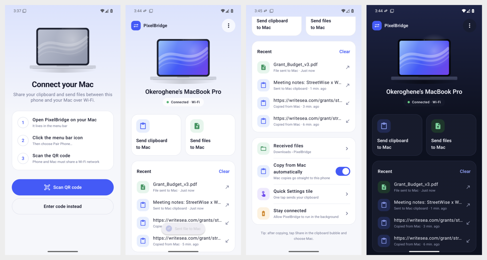

# Link to Mac

Shared clipboard and file transfer between a Mac and an Android phone (built for the Pixel 10 Pro) over your local Wi-Fi. No cloud and no account. Everything is end-to-end encrypted with a key you pair once.



| Feature | How it works |
|---|---|
| **Clipboard, Mac → phone** | Automatic: copy on the Mac, paste on the phone (text and images) |
| **Clipboard, phone → Mac** | Automatic after a one-time setup from the Mac (**Set Up Phone…**). Without it: the **Send to Mac** tile, the notification button, or **Share → Mac** |
| **Files** | Mac → phone: drop on the menu bar icon, **Send Files to Phone…**, or Finder → Services. Phone → Mac: **Share → Mac**. Mac files land in `Downloads/PixelBridge` on the phone; phone files land in `~/Downloads` on the Mac |
| **Phone Screen** | Menu bar → **Phone Screen** shows your phone in a window you can use with the mouse and keyboard (scrcpy) |
| **Notifications** | Phone notifications appear on the Mac. **Reply** and **Clear on Phone** work from the notification |
| **Calls** | When the phone rings, the Mac rings too and shows who's calling, with **Decline** and **Silence**. Answer on the phone |
| **Text messages** | Menu bar → **Messages** shows your SMS conversations |

> **Limits worth knowing**
> - *Automatic phone → Mac clipboard* uses the method KDE Connect uses. Android only lets the on-screen app read the clipboard, so Link to Mac needs two one-time permissions granted from the Mac. Android also asks **"Allow access to device logs?"** whenever Link to Mac restarts (for example after a phone reboot). Tap the Link to Mac notification and choose **Allow one-time access**.
> - *Messages* shows **SMS only**. Google Messages keeps RCS chats private to itself, but they still reach the Mac as notifications you can reply to.
> - *Calls* ring on the Mac, but the audio stays on the phone.

## Download

Get the latest version from **[Releases](https://github.com/Okeroghenex/PixelBridge/releases/latest)**:

| File | For |
|---|---|
| `Link-to-Mac-<version>.dmg` | macOS 13 or later, Apple Silicon and Intel |
| `LinkToMac-<version>.apk` | Android 10+, **full** version: everything, including notifications, calls and text messages |
| `LinkToMac-Lite-<version>.apk` | Android 10+, **Lite**: clipboard, files, Lock Mac and Phone Screen; installs anywhere |

Each file has a `.sha256` checksum next to it.

**Installing on Android**
- Open the APK on your phone and allow your browser or file manager to install apps when asked.
- **"App blocked to protect your device"** (full version only): in some countries, Android blocks downloaded apps that read SMS or notifications. Install **Lite** instead, or install the full version from a computer with `adb install LinkToMac-<version>.apk`.
- After installing the full version, if notification or SMS access is greyed out: **Settings › Apps › Link to Mac › ⋮ › Allow restricted settings**.
- Both versions use the same signing key, so you can switch between them without losing your pairing.

**Installing on Mac**
- Open the DMG and drag **Link to Mac** into **Applications**.
- The app isn't notarized by Apple yet, so the first launch is blocked. Open **System Settings › Privacy & Security** and click **Open Anyway**. You only need to do this once.

## Building from source

### 1. Mac app

Needs only the Xcode Command Line Tools (already installed here).

```bash
cd ~/Desktop/PixelBridge/mac && ./build-app.sh
```

```bash
mv ~/Desktop/PixelBridge/mac/dist/"Link to Mac.app" /Applications/ && open "/Applications/Link to Mac.app"
```

- A phone icon appears in the menu bar. The first launch opens the **Pair your Android phone** window.
- Allow **Local Network** access and **incoming connections** if macOS asks, and allow notifications.
- Menu bar → **Launch at Login** keeps it running.

### 2. Android app

1. Install [Android Studio](https://developer.android.com/studio) and open the `android/` folder (**File → Open**). The first Gradle sync downloads the SDK and dependencies.
2. On the Pixel: **Settings → About phone →** tap **Build number** 7 times, then **System → Developer options → USB debugging** on.
3. Plug in the phone, select it in the device dropdown, and press **Run ▶**.
   Or build a small (about 2.5 MB) installable APK from the terminal, then copy `android/app/build/outputs/apk/release/app-release.apk` to the phone:

   ```bash
   cd ~/Desktop/PixelBridge/android && ./gradlew assembleFullRelease assembleLiteRelease
   ```

   Release builds are signed with the key in `~/.linktomac/signing.properties` if it exists, otherwise with the debug key.

## Pair

1. On the Mac: menu bar icon → **Pair Phone…**
2. On the phone: open Link to Mac → **Scan pairing QR code**. Pointing the Pixel camera at the QR code works too.
   No camera? Use **Enter pairing code** and type the code shown under the QR code.
3. The status changes to **Connected to <your Mac>**.
4. On the phone, tap **Add “Send to Mac” Quick Settings tile** and **Let it stay connected in the background**.

The phone finds the Mac automatically over Bonjour/mDNS, and falls back to the Mac's IP address saved during pairing. Both devices must be on the same network. Some guest or office Wi-Fi networks block devices from talking to each other.

## Turn on the extras (once)

On the phone, open Link to Mac and look at the **On your Mac** card:
- **Notifications & calls → Allow**: turn on Link to Mac under *Notification access*.
- **Text message history → Allow**: allow SMS and Contacts access.

On the Mac, choose menu bar → **Set Up Phone…**:
1. On the phone, go to **Settings → System → Developer options → Wireless debugging** and turn it on.
2. Tap **Pair device with QR code** and scan the code in the Mac window. The Mac pairs by itself.
   Or choose **Pair with pairing code** in the Mac window, tap **Pair device with pairing code** on the phone, and type the **IP address & Port** and the **pairing code** it shows.
3. Click **Turn On** next to *Copy on phone, paste on Mac*. On the phone, tap **Allow one-time access**.
4. Click **Open** next to *Phone Screen*.

Wireless debugging switches off when the phone leaves your Wi-Fi network. Turn it back on to use **Phone Screen**; automatic clipboard keeps working without it.

## Everyday use

- **Copy on the Mac → paste on the Pixel.** Nothing else to do.
- **Copy on the Pixel → paste on the Mac:** automatic once set up. Without the setup, tap **Share** in the clipboard bubble and pick **Mac**, or use the **Send to Mac** Quick Settings tile.
- **Phone rings:** your Mac rings and shows a card at the top right. Pick up on the phone, or click **Decline** or **Silence** on the Mac.
- **Messages:** reply straight from the Mac notification. Menu bar → **Messages** shows your SMS history.
- **Photo or file to the Mac:** Share → **Mac**. It lands in `~/Downloads` with a notification; click it to show the file in Finder.
- **File to the phone:** drag it onto the menu bar icon. On the phone it lands in **Files → Downloads → Link to Mac**.
- Turn off **Sync Clipboard Automatically** in the Mac menu to stop pushing Mac copies, or turn the switch off in the phone app.

## Releasing

1. Raise `versionCode` and `versionName` in `android/app/build.gradle.kts`, and `VERSION` and `BUILD` in `mac/build-app.sh`.
2. Build the Android release with `./gradlew assembleFullRelease assembleLiteRelease`. Build the Mac DMG with `mac/build-app.sh && mac/make-dmg.sh`. Universal builds need only the Command Line Tools.
3. Upload the files from `dist/` to a GitHub release, together with their `.sha256` files.

**Keep `~/.linktomac/release.jks` and `signing.properties` backed up and private.** Every future Android update must be signed with this key, or it won't install over the old version.

For a Mac download that opens without the Gatekeeper warning, sign the app with an Apple **Developer ID** certificate, notarize it with `xcrun notarytool`, then staple the ticket. This needs a paid Apple Developer account.

## License

MIT (see `LICENSE`). Bundled third-party components are listed in `THIRD_PARTY_NOTICES.md`.

## Branding

The logo files live in `branding/`. The Android launcher icon is an adaptive icon built from them, so each launcher crops it to its own shape: a circle on Pixel, a squircle on Samsung, a square on others. `mac/tools/make-icons.swift` turns them into the Mac app icon and menu bar icon whenever the app is built.

## Security

- Pairing creates a random 128-bit secret on the Mac (`~/Library/Application Support/PixelBridge/pairing.key`, mode 600).
- Each connection derives a fresh AES-256-GCM key (HKDF-SHA256 with random nonces from both sides). Every frame is authenticated and counter-numbered, so tampered, replayed or wrong-key traffic is rejected.
- Notifications, calls and SMS travel over the same encrypted connection. Nothing is stored on the Mac, and Messages are fetched from the phone each time you open them.
- `Set Up Phone…` uses adb (Android's developer bridge) and scrcpy 5.0.1. The build script downloads scrcpy from its GitHub release and checks it against a pinned SHA-256.
- Clipboard items marked as passwords by 1Password, Bitwarden, Keychain and similar apps (`org.nspasteboard.ConcealedType`) are never sent.
- **Reset Pairing Code…** in the Mac menu revokes the phone instantly.

Details of the wire format are in [PROTOCOL.md](PROTOCOL.md).

## Testing without a phone

`bridge-test-client` pretends to be the phone:

```bash
cd ~/Desktop/PixelBridge/mac && swift build && .build/debug/bridge-test-client --keyfile --text "hi from fake phone" --wait 10
```

While it waits, anything you copy on the Mac is printed as `RECV clip_text …`.

## Troubleshooting

- **Logs:** `~/Library/Logs/PixelBridge.log` (connections and event types only, never message contents) and `~/Library/Logs/PixelBridge-scrcpy.log`.
- **Automatic copy stopped after a phone restart:** tap Link to Mac's *"Tap to turn on automatic copy"* notification, then choose **Allow one-time access**.
- **Phone Screen opens Set Up Phone instead:** turn Wireless debugging on again on the phone, or plug it in with USB.

- **Phone stuck on "Looking for your Mac…"**: check that both are on the same Wi-Fi, that the Mac menu says "Waiting for phone…", and that **System Settings → Privacy & Security → Local Network → Link to Mac** is on. Then use **Enter pairing code** with the Mac's IP address shown in the pairing window.
- **"Pairing code rejected"**: the Mac's code was reset. Pair again.
- **Connection drops when the phone sleeps**: tap **Let it stay connected in the background** in the phone app.
- **Finder Services item missing**: log out and back in once after moving the app to /Applications.
